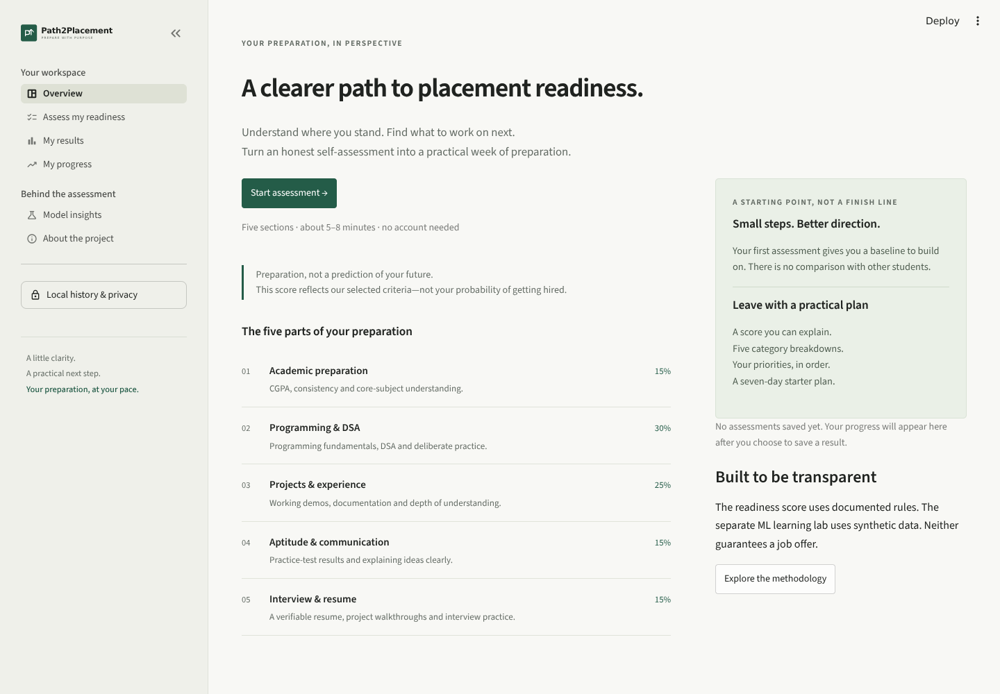
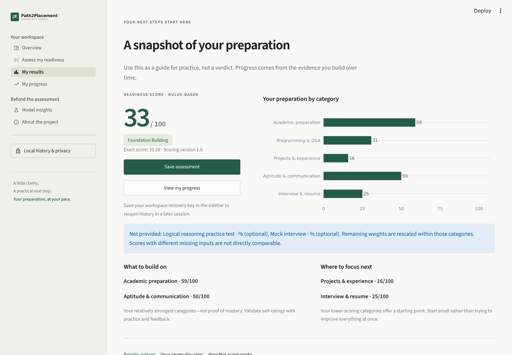

> **Legacy local-Streamlit guide.** The deployed web version uses Flask + Vite and browser-local history. See the root README and [Vercel guide](VERCEL.md) for the current deployment. SQLite and workspace keys below apply only to the local Streamlit app.

# Path2Placement
### Prepare with purpose. Understand your next step.

A functional **Streamlit student placement-readiness self-assessment** with
transparent scoring, prioritized coaching, a seven-day practice plan, SQLite
history and an honestly labeled machine-learning learning lab.

> **Readiness ≠ placement probability.** The main score uses documented rules,
> not ML. The classifiers use **synthetic interview-exercise outcomes**, not
> genuine placement records. No part of this app guarantees employment or ranks
> students against one another.

## What works

- Five-step assessment with preserved section answers, optional blank test scores,
  contextual help, range checks, consistency validation and a review screen.
- Reproducible 0–100 score; five category scores and supportive readiness bands.
- Strengths, gaps, input-linked ordered recommendations and a downloadable seven-day plan.
- Explicit save action; genuine SQLite history, trend chart, category changes,
  CSV export, historical input inspection and confirmed deletion.
- Workspace-key isolation for history; no names, email addresses or passwords required.
- Separate synthetic learning lab: three classifiers, five-fold CV, held-out metrics,
  confusion matrix, class counts, permutation importance and working inference.
- Forest-green/off-white visual system, meaningful Plotly charts, native page navigation
  and layouts checked at desktop and mobile widths.
- Automated scoring, preprocessing, inference, database and Streamlit integration tests.

<details>
<summary>See the working application</summary>




Screenshots are from the running app, not mockups. The displayed result uses the
editable default demonstration inputs; it is not a real student's record.

</details>

## Quick start (Python 3.11 recommended)

The checked-in dataset and small trusted model artifact make training optional.
Install the pinned dependencies so the saved Scikit-learn pipeline is compatible.

### macOS / Linux

```bash
git clone https://github.com/suyashpandey8088-cell/PlacementReadinessPredic.git
cd PlacementReadinessPredic
git checkout arena/cb92804d-placementreadinesspredic
python3 -m venv .venv
source .venv/bin/activate
python -m pip install -r requirements-streamlit.txt
streamlit run app.py
```

### Windows PowerShell

```powershell
git clone https://github.com/suyashpandey8088-cell/PlacementReadinessPredic.git
cd PlacementReadinessPredic
git checkout arena/cb92804d-placementreadinesspredic
py -3.11 -m venv .venv
.\.venv\Scripts\Activate.ps1
python -m pip install -r requirements-streamlit.txt
streamlit run app.py
```

If activation is restricted, avoid changing system policy; invoke the environment
executables directly:

```powershell
.\.venv\Scripts\python.exe -m pip install -r requirements-streamlit.txt
.\.venv\Scripts\python.exe -m streamlit run app.py
```

Windows Command Prompt activation: `.venv\Scripts\activate.bat`.
Open the URL printed by Streamlit (normally `http://localhost:8501`). The core
application does not require an API key, cloud database, LLM or paid service.
Installing dependencies requires internet; after installation local scoring,
training, history and inference do not require an external service. Browser/system
font fallbacks are provided.

### Training and tests

```bash
# Regenerate the explicitly synthetic data and all saved artifacts
python -m src.train_model --generate

# Or train on the existing, validated synthetic CSV
python -m src.train_model

# All unit and Streamlit integration tests
python -m pytest -q
```

Do not retrain on each UI interaction. Only the command above performs training.
After replacing artifacts while the server is running, restart Streamlit to clear
its model resource cache. If loading failed, the learning lab also offers Retry.

## Take an assessment

1. Choose **Start assessment** and submit each of the five sections. The section
   buttons preserve answers; use them before navigating away from an unsent form.
2. Use honest self-ratings: 1 Beginner, 2 Basic, 3 Intermediate, 4 Strong,
   5 Advanced. Hover over help icons for behavioral descriptions.
3. Leave logical reasoning or mock-interview scores blank if no test was taken.
4. Review the answers. Inconsistent counts receive a specific error and cannot be scored.
5. Calculate, inspect category contributions, priorities and the seven-day plan.
6. Choose **Save assessment** to persist. Copy your recovery key from
   **Local history & privacy** before ending the browser session.
7. Save a later assessment to compare progress, or export/delete your history.

There are no seeded student records, testimonials, salary claims or success rates.
The default form values are editable starting values, **not a saved assessment**.

## Scoring, explained

Configuration lives in `src/config.py`, version **1.0**:

| Category | Overall weight | Within-category inputs and weights |
|---|---:|---|
| Academic preparation | 15% | CGPA 45%, consistency 20%, core subjects 35% |
| Programming & DSA | 30% | languages 10%, programming 30%, DSA 40%, problems 20% |
| Projects & experience | 25% | completed 10%, demos 20%, documented 15%, implementation 50%, internship 5% |
| Aptitude & communication | 15% | aptitude 35%, optional reasoning 15%, communication 25%, explanation 25% |
| Interview & resume | 15% | optional mock 25%, resume 30%, preparation 25%, project explanation 20% |

- A 1–5 rating becomes `(rating − 1) / 4 × 100`.
- CGPA becomes `cgpa / 10 × 100`; percentages are unchanged.
- Counts become `min(count / cap, 1) × 100`. Caps: languages **3**, understood
  coding problems **250**, completed projects **3**, working demos **2**,
  documented projects **2**. Quality has more influence than count.
- Internship is 0 for no experience, 100 for completed. Its maximum overall
  contribution is just **1.25 points**.
- Missing optional tests are excluded; remaining weights are rescaled **within
  that category only**. Required inputs cannot be missing. No neutral test score
  is invented. Different optional coverage can change comparability; the UI warns.
- Demos/documented counts cannot exceed completed projects. Zero projects requires
  implementation rating 1; zero languages requires programming rating 1.
- Category scores are weighted normalized inputs. Overall score is the sum of
  category score × overall weight, computed at full precision and rounded to two
  decimals. A whole-number headline is accompanied by the exact score.

Bands use the exact score: **0–<40** Foundation Building; **40–<60** Developing;
**60–<75** Progressing Toward Readiness; **75–<90** Nearly Ready; **90–100**
Strong Preparation. These thresholds and weights are design choices, **not
scientifically validated employability boundaries**.

Same inputs and scoring version produce the same result. Count caps prevent
unlimited points for quantity. Recommendations use actual low inputs and category
gaps, sorted by affected category score; each includes a reason and completion
criterion. Strong preparation receives optional maintenance/feedback tasks.

## Data strategy and ML evaluation

No trustworthy real-outcome dataset was supplied in the empty starting repository.
The project therefore uses the documented **synthetic fallback** rather than
making unsupported claims. See [the data card](../data/README.md) for exact feature
ranges, generation equations, target meaning, licensing notes and replacement rules.

Workflow: schema/range/target validation → duplicate predictor removal → stratified
80/20 split → five-fold stratified CV on training rows → select highest mean F1 →
fit once on training rows → evaluate the selected model on the untouched test set.
A `Pipeline` and `ColumnTransformer` fit imputation, scaling and one-hot encoding
inside training folds. Target/future variables are never predictors.

Measured on the committed 1,400-row synthetic dataset, seed 42:

| Candidate | Mean five-fold training CV F1 |
|---|---:|
| Logistic Regression | 0.6976 |
| Decision Tree | 0.6046 |
| Random Forest | 0.6621 |

**Selected: Logistic Regression.** Held-out 280-row synthetic test:
accuracy **0.7250**, precision **0.6984**, recall **0.6929**, F1 **0.6957**.
Confusion matrix (actual rows 0/1, predicted columns 0/1): `[[115, 38], [39, 88]]`.

These are computed results, **not evidence of real-world placement accuracy**.
Accuracy is the fraction correct; precision is the fraction of predicted simulated
passes that pass; recall is the fraction of simulated passes detected; F1 balances
precision and recall. A false positive predicts a simulated pass for a failure;
a false negative misses a simulated pass. Neither is a real employment forecast.
Class distribution, missingness, CV standard deviation/fold results and repeat-shuffle
importance are in the [evaluation report](../reports/model_evaluation.md), metadata
and Model insights page. Importance is not causation.

`models/placement_model.joblib` and `model_metadata.json` are intentionally committed:
they are small, locally generated trusted artifacts. Metadata includes schema,
versions, timestamp, checksums, selection/evaluation results and limitations.
**Never load untrusted Joblib files**: pickle-based formats can execute code.
The checksum detects accidental mismatch, not malicious modification of both files.

## Architecture and data flow

```text
app.py                         Page registration, identity, navigation
assets/                        Small static SVG wordmark/icon
.streamlit/config.toml         Consistent theme and bind address
src/config.py                  Input schema, caps, weights and bands
src/readiness_scoring.py        Validation, normalization, deterministic score
src/recommendations.py          Ranked coaching rules and daily plan
src/database.py                 Workspace-isolated SQLite queries and CSV export
src/data_preprocessing.py       Synthetic generator, dataset checks, preprocessing
src/train_model.py              Reproducible CV, selection, evaluation, serialization
src/evaluation.py               Held-out metric computation
src/predict.py                  Trusted artifact validation and lab inference
src/ui.py                      All seven page renderers; no training on reruns
data/                          Synthetic CSV, data card; ignored local SQLite file
models/                        Saved small pipeline and measured metadata
reports/                       Evaluation report and verification notes
tests/                         Unit and Streamlit integration tests
docs/PORTFOLIO.md               Demo script, study guide, interview Q&A, roadmap
.github/workflows/tests.yml    Repeatable tests on future pushes (not a deployment)
```

Assessment widgets → session draft → validation/review → rules-based scoring →
recommendations/plan → explicit SQLite save. Progress reads only records matching
the current hashed workspace key. Pandas flattens them for CSV; Plotly visualizes
actual category scores and history. Independent lab inference validates a seven-feature
DataFrame and sends it through the exact saved preprocessing/classifier pipeline.

**Why these libraries?** Streamlit supplies interactive Python UI and session state;
Pandas structures tables/CSV; NumPy generates reproducible simulated data;
Scikit-learn provides leakage-safe pipelines and metrics; Joblib serializes the
pipeline; Plotly provides readable interactive charts; SQLite supplies standard-library
local persistence; Pytest and Streamlit AppTest verify logic and user flows.

## Persistence, privacy and limitations

SQLite defaults to `data/history.sqlite3`. Override with `PATH2PLACEMENT_DB`:

```bash
export PATH2PLACEMENT_DB=/path/to/writable/history.sqlite3
```

PowerShell: `$env:PATH2PLACEMENT_DB = "C:\path\history.sqlite3"`.
The file and its sidecars are ignored by Git. Stored data: random assessment ID,
UTC timestamp, **hashed** workspace key, scores, scoring version, inputs and
recommendations. All queries use bound parameters and every read/delete is scoped
to a workspace. An assessment ID makes saving idempotent across reruns.

The random 256-bit recovery key lives in session state, not URLs. A fresh session
creates a new workspace; restore a saved key in the sidebar to reopen history.
There is **no account system or enterprise authentication**. Anyone with a key can
access that workspace; server operators and anyone with disk access can read the
unencrypted database. Lost keys cannot be recovered by this UI. Do not use this
prototype for confidential or high-stakes records. Clearing removes the active
workspace's records, not external backups. A new workspace does not delete old data.

Hosted SQLite is on the **host**, not the student's device, and may disappear on
restarts or not be shared between replicas. Export important records. For actual
public institutional use, first add authentication, authorization, TLS, secure
backups, retention/consent policies and a reviewed storage design. Self-ratings,
unequal opportunities and unmeasured employer/context factors limit interpretation.
The app is not suitable for hiring, ranking, admission or guaranteed outcomes.

## Deployment (prepared; no hosted deployment claimed)

A compatible long-running Python/Streamlit host is required. Streamlit Community
Cloud may offer a free tier subject to its current eligibility and resource limits.

1. Push this branch to GitHub (instructions below).
2. In the hosting platform, select this repository, branch
   `arena/cb92804d-placementreadinesspredic`, and entry file `app.py`.
3. Choose Python **3.11**, install `requirements.txt`, and launch
   `streamlit run app.py` (Community Cloud manages the launch itself).
4. On a custom host, bind `0.0.0.0` and use the host-assigned port. Configuration
   already binds all interfaces. Keep Streamlit's default CORS/XSRF safeguards on.
5. Test the public URL, form, charts, exports, workspace isolation and persistence.
   If versions change, retrain artifacts. Do not confuse a running development
   preview with a durable deployment.

The core does not need Supabase, Vercel or any connected external service. It is a
stateful Streamlit server, not a static page or ordinary serverless frontend.

### GitHub workflow

Changes for this implementation belong to the fixed working branch:

```bash
git status
git add app.py src tests data models reports docs assets .streamlit .github README.md requirements.txt .gitignore
git commit -m "Build Path2Placement readiness assessment and synthetic ML lab"
git push origin arena/cb92804d-placementreadinesspredic
```

Optionally open a pull request from this branch into `main` using GitHub's interface
or `gh pr create --base main --head arena/cb92804d-placementreadinesspredic`.
Never commit `.venv`, recovery keys, private history, secrets or large external datasets.

## Verification and troubleshooting

See [verification notes](../reports/verification.md) for actually executed checks.

| Symptom | Recovery |
|---|---|
| `streamlit` not found | Activate the venv or use `python -m streamlit run app.py` |
| Missing or incompatible model | Run `python -m src.train_model --generate`; restart app. Main scoring still works |
| Missing dataset | Run training with `--generate` to recreate it |
| Database unavailable | Set `PATH2PLACEMENT_DB` to a writable file path, not a directory. Assessments still calculate without saving |
| No old history after refresh | Restore the full recovery key. A new session is intentionally isolated |
| Hosted history lost | Storage may be ephemeral. Restore from your own CSV copy (CSV import is not implemented) |
| Different totals after leaving optional tests blank | Missing inputs rescale category weights; compare like-for-like coverage |
| Invalid demo/documented count | Counts must not exceed completed projects |
| Form changes vanished after page navigation | Submit the section before using sidebar navigation; unsent forms are temporary |
| Model changes not visible | Restart the app to clear the cached resource |

For the 4–7-day student implementation plan, concise interview answers, limitations,
a 3–5-minute demo script and resume-ready wording, see [the portfolio guide](PORTFOLIO.md).
